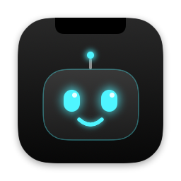
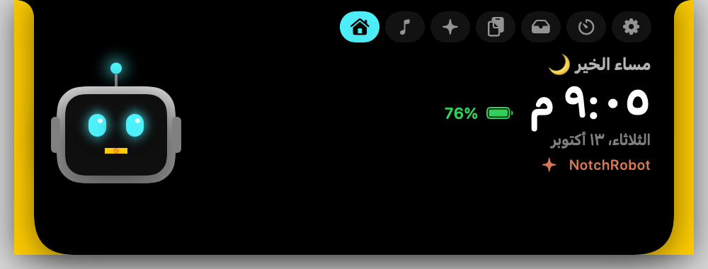
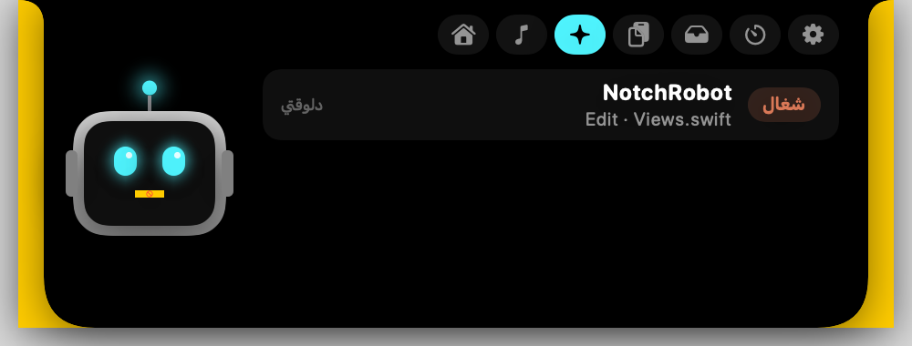

<div align="center">



# NotchRobot

**A little robot that lives in your MacBook's notch — and keeps an eye on Claude Code for you.**

[Download](https://github.com/abdomo77/NotchRobot/releases/latest) · [Build from source](#build-from-source) · [العربي](#بالعربي)



</div>

---

## Features

- **Claude Code in the notch.** See every running `claude` session (working, waiting, or done), and click one to jump to its terminal tab (Terminal and iTerm2).
- **Approve or deny from the notch.** When Claude asks for permission to use a tool, you can **Allow**, **Deny**, or send it back to the terminal without leaving what you're doing.
- **Answer Claude's questions.** Single-choice questions, multi-select questions, and several questions in a row (with Next / Back) all work from the notch.
- **Alerts.** A banner and a sound when Claude finishes, needs you, or hits an error, even over fullscreen apps.
- **Now playing.** Shows the current song and artwork from Spotify, Apple Music, or YouTube, with the accent color taken from the artwork.
- **Clipboard history.** Keeps your last 20 copies.
- **Shelf.** Drag files onto the notch to keep them handy.
- **Timer, battery, clock, and date.**
- **The robot.** His eyes follow your mouse, and he blinks, sleeps, and reacts to what Claude is doing.

<p align="center">
  
  
</p>

> The interface is in Egyptian Arabic.

## Requirements

- An Apple Silicon Mac. Any Mac works, but the notch looks best on one with a notch.
- macOS 13 Ventura or later.
- [Claude Code](https://claude.com/claude-code), for the Claude features.

## Install

1. Download `NotchRobot.zip` from the [latest release](https://github.com/abdomo77/NotchRobot/releases/latest) and unzip it.
2. Move `NotchRobot.app` to `/Applications`.
3. The app isn't notarized, so macOS will block it the first time. Allow it with:
   ```sh
   xattr -dr com.apple.quarantine /Applications/NotchRobot.app
   ```
   Or open it once, then go to **System Settings → Privacy & Security → Open Anyway**.
4. Connect it to Claude Code by running this from the unzipped folder:
   ```sh
   ./install-hooks.sh
   ```
5. Open NotchRobot, then restart any running `claude` sessions.

To start NotchRobot with your Mac, turn on **يفتح مع تشغيل الماك** in the settings tab.

## Build from source

You need the Xcode Command Line Tools (`xcode-select --install`).

```sh
git clone https://github.com/abdomo77/NotchRobot.git
cd NotchRobot
./build.sh install     # builds, copies to /Applications, and launches it
./install-hooks.sh     # connects it to Claude Code
```

`./build.sh` without `install` only builds `NotchRobot.app` in the project folder.

## How the Claude Code integration works

`install-hooks.sh` copies [`hook.sh`](hook.sh) to `~/.notchrobot/` and registers it for these Claude Code [hooks](https://docs.claude.com/en/docs/claude-code/hooks) in `~/.claude/settings.json`: `SessionStart`, `SessionEnd`, `UserPromptSubmit`, `PreToolUse`, `PostToolUse`, `PostToolUseFailure`, `Notification`, `Stop`, `StopFailure`, and `PermissionRequest`. Before changing anything, it backs up your settings to `settings.json.bak-notchrobot`.

- Each hook event is written to `~/.notchrobot/inbox/`, and the app picks it up from there.
- For `PermissionRequest`, the hook waits up to 5 minutes for your answer from the notch. If you don't answer, or you press **التيرمنال**, Claude asks in the terminal as usual.
- If NotchRobot isn't running, the hook exits immediately and Claude Code behaves exactly as before.

If you prefer to set it up by hand, add `~/.notchrobot/hook.sh` as a `command` hook for each event above. Use `"matcher": "*"` for the tool events, and set a `timeout` of `310` for `PermissionRequest`.

## Permissions

- **Automation**: used to find the right Terminal or iTerm2 tab, and to read the YouTube tab in your browser for song artwork. macOS asks the first time.

## Uninstall

```sh
pkill -x NotchRobot; rm -rf /Applications/NotchRobot.app ~/.notchrobot
```

Then remove the `.notchrobot/hook.sh` entries from `~/.claude/settings.json`, or restore `settings.json.bak-notchrobot`.

---

## بالعربي

روبوت صغير بيعيش في النوتش بتاع الماك وبيتابعلك جلسات Claude Code. بيوريك كل جلسة شغالة وتوصلك منه تنبيهات لما كلود يخلص أو يحتاجك. وتقدر من النوتش توافق على طلبات الإذن أو ترفضها، وتجاوب على أسئلة كلود سواء كانت اختيار واحد أو أكتر من اختيار أو أكتر من سؤال. وكمان فيه الأغنية الشغالة، وتاريخ الكليب بورد، ورف للملفات، وتايمر.

**التسطيب:**
1. نزّل `NotchRobot.zip` من [آخر إصدار](https://github.com/abdomo77/NotchRobot/releases/latest) وفكّه.
2. انقل `NotchRobot.app` لفولدر `/Applications`.
3. شغّل الأمر ده عشان الماك يسمح بفتح التطبيق:
   `xattr -dr com.apple.quarantine /Applications/NotchRobot.app`
4. شغّل `./install-hooks.sh` من نفس الفولدر عشان تربطه بكلود كود.
5. افتح التطبيق، وبعدين اقفل أي جلسة `claude` شغالة وافتحها تاني.

## License

[MIT](LICENSE) © Abdelrhman Moahmed
