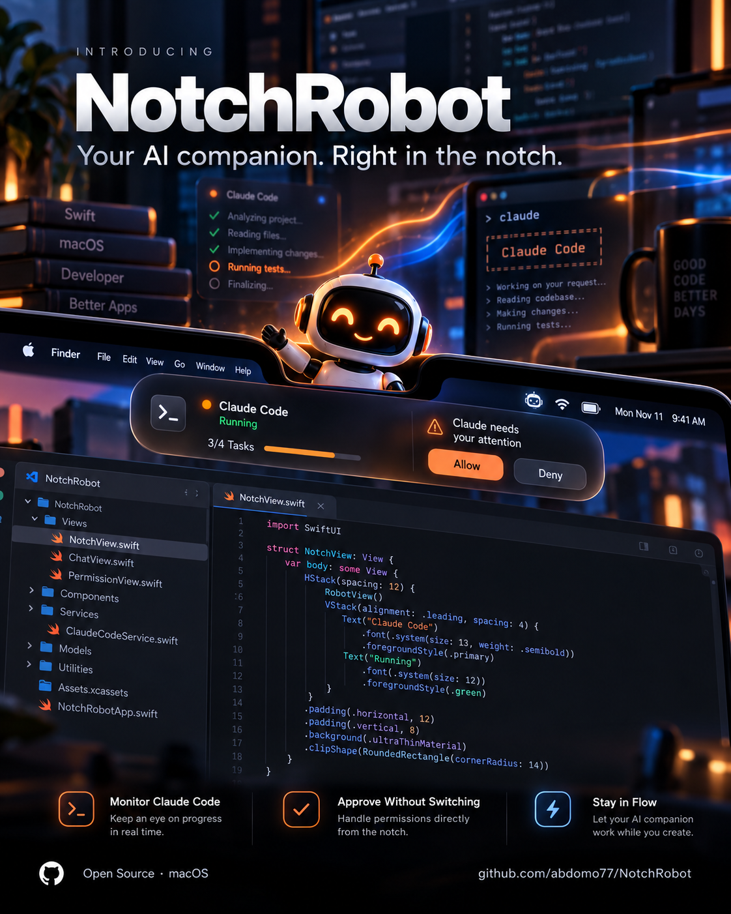
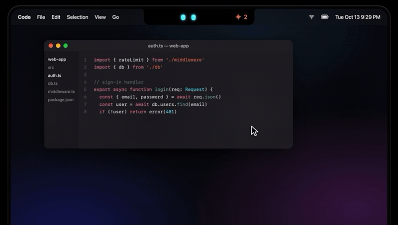
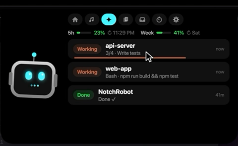
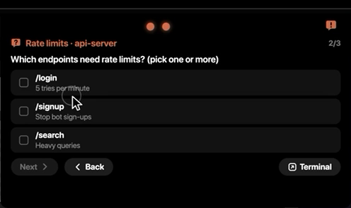
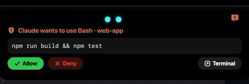
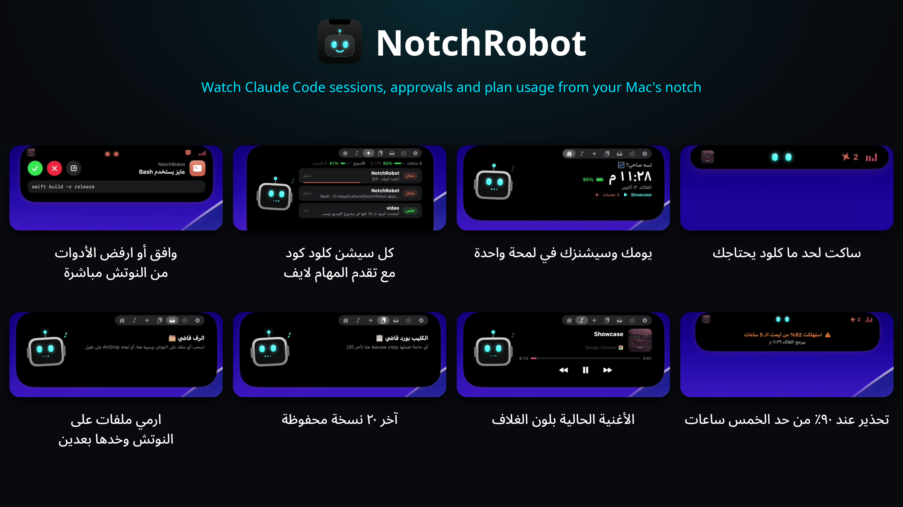

<div align="center">



# NotchRobot

<p>
  <a href="LICENSE"></a>
  <a href="https://github.com/abdomo77/NotchRobot/releases/latest"></a>
  
  <a href="https://github.com/abdomo77/NotchRobot/stargazers"></a>
</p>

**A little robot that lives in your MacBook's notch — and keeps an eye on Claude Code for you.**

[Download](https://github.com/abdomo77/NotchRobot/releases/latest) · [Build from source](#build-from-source) · [العربي](#بالعربي)



</div>

---

## Why NotchRobot?

[Vibe Notch](https://github.com/farouqaldori/vibe-notch) also offers notch permission approvals and session monitoring. Choose NotchRobot for multi-step question cards answered in the notch, 5-hour and weekly plan usage with 90% and reset alerts, task progress, and Arabic RTL support alongside an English UI.

## Features

- **Looks like the Dynamic Island.** A pill that springs open into a rounded island, with SF Pro, iOS colors, and blur transitions.
- **Claude Code in the notch.** See every running `claude` session (working, waiting, or done), and click one to jump to its terminal tab (Terminal and iTerm2).
- **Approve or deny from the notch.** When Claude asks for permission to use a tool, you can **Allow**, **Deny**, or send it back to the terminal without leaving what you're doing. The card stays until you answer, even while Claude runs other tools or subagents.
- **Answer Claude's questions.** Single-choice questions, multi-select questions, and several questions in a row (with Next / Back) all work from the notch.
- **Account usage.** Your Claude plan's 5-hour and weekly usage, with when each one resets (Pro and Max plans). The notch warns you once when either limit reaches 90%, and tells you once when it's back.
- **Task progress.** When Claude works through a task list, each session shows `2/4` and a progress bar, plus the task it's on now.
- **Alerts.** A banner and a sound when Claude finishes, needs you, or hits an error, even over fullscreen apps.
- **Now playing.** Shows the current song and artwork from Spotify, Apple Music, or YouTube, with the accent color taken from the artwork. Drag the progress bar to seek.
- **Clipboard history.** Keeps your last 20 copies.
- **Shelf.** Drag files onto the notch to keep them handy.
- **Timer, battery, clock, and date.**
- **The robot.** His eyes follow your mouse, and he blinks, sleeps, and reacts to what Claude is doing.
- **Swipe between tabs.** Swipe left or right with two fingers on the trackpad while the notch is open.
- **English and Arabic.** It follows your Mac's language, and you can switch in Settings.
- **Update check.** It tells you when a new version is out on GitHub.

<p align="center">
  
  
</p>
<p align="center">
  
</p>

## Feature showcase

<p align="center">
  
</p>

## Requirements

- An Apple Silicon Mac for the downloadable release. A built-in notch is optional. Intel builds from source have not been verified.
- macOS 13 Ventura or later.
- [Claude Code](https://claude.com/claude-code), for the Claude features.

## Install

1. Download `NotchRobot.zip` from the [latest release](https://github.com/abdomo77/NotchRobot/releases/latest) and unzip it.
2. Move `NotchRobot.app` to `/Applications`.
3. The app isn't notarized, so macOS will block it the first time. Allow it with:
   ```sh
   xattr -dr com.apple.quarantine /Applications/NotchRobot.app
   ```
   Or open it once, then go to **System Settings → Privacy & Security → Open Anyway**.
4. Connect it to Claude Code by running this from the unzipped folder:
   ```sh
   ./install-hooks.sh
   ```
5. Open NotchRobot, then restart any running `claude` sessions.

To start NotchRobot with your Mac, turn on **يفتح مع تشغيل الماك** in the settings tab.

## Build from source

You need the Xcode Command Line Tools (`xcode-select --install`).

```sh
git clone https://github.com/abdomo77/NotchRobot.git
cd NotchRobot
./build.sh install     # builds, copies to /Applications, and launches it
./install-hooks.sh     # connects it to Claude Code
```

`./build.sh` without `install` only builds `NotchRobot.app` in the project folder.

## How the Claude Code integration works

`install-hooks.sh` copies [`hook.sh`](hook.sh) and [`statusline.sh`](statusline.sh) to `~/.notchrobot/` and registers it for these Claude Code [hooks](https://docs.claude.com/en/docs/claude-code/hooks) in `~/.claude/settings.json`: `SessionStart`, `SessionEnd`, `UserPromptSubmit`, `PreToolUse`, `PostToolUse`, `PostToolUseFailure`, `Notification`, `Stop`, `StopFailure`, and `PermissionRequest`. Before changing anything, it backs up your settings to `settings.json.bak-notchrobot`.

- Each hook event is written to `~/.notchrobot/inbox/`, and the app picks it up from there.
- For `PermissionRequest`, the hook waits up to 5 minutes for your answer from the notch. If you don't answer, or you press **التيرمنال**, Claude asks in the terminal as usual.
- If NotchRobot isn't running, the hook exits immediately and Claude Code behaves exactly as before.

### Account usage

Claude Code only shares your plan's usage with its [status line](https://code.claude.com/docs/en/statusline), so `install-hooks.sh` also sets `statusline.sh` as your status line. It saves the numbers to `~/.notchrobot/usage.json` for the notch and prints a short `5h 23% · 7d 41%` line in Claude Code.

- It only works on **Pro and Max** plans, and the numbers update while a `claude` session is running.
- If you already have a status line, the installer leaves it alone. To keep yours and still get usage in the notch, add this to your status line script:
  ```sh
  input=$(cat); printf '%s' "$input" | ~/.notchrobot/statusline.sh >/dev/null
  ```

If you prefer to set it up by hand, add `~/.notchrobot/hook.sh` as a `command` hook for each event above. Use `"matcher": "*"` for the tool events, and set a `timeout` of `310` for `PermissionRequest`.

## Permissions

- **Automation**: used to find the right Terminal or iTerm2 tab, and to read the YouTube tab in your browser for song artwork. macOS asks the first time.

## Uninstall

```sh
pkill -x NotchRobot; rm -rf /Applications/NotchRobot.app ~/.notchrobot
```

Then remove the `.notchrobot/hook.sh` entries and the `statusLine` from `~/.claude/settings.json`, or restore `settings.json.bak-notchrobot`.

---

## بالعربي

روبوت صغير بيعيش في النوتش بتاع الماك وبيتابعلك جلسات Claude Code. بيوريك كل جلسة شغالة وتوصلك منه تنبيهات لما كلود يخلص أو يحتاجك. وتقدر من النوتش توافق على طلبات الإذن أو ترفضها، وتجاوب على أسئلة كلود سواء كانت اختيار واحد أو أكتر من اختيار أو أكتر من سؤال. وبيعرض استهلاك حسابك في الـ 5 ساعات وفي الأسبوع، وتقدم المهام في كل جلسة. وكمان فيه الأغنية الشغالة، وتاريخ الكليب بورد، ورف للملفات، وتايمر. الواجهة بالعربي والإنجليزي، وبيقولك لما ينزل إصدار جديد.

**التسطيب:**
1. نزّل `NotchRobot.zip` من [آخر إصدار](https://github.com/abdomo77/NotchRobot/releases/latest) وفكّه.
2. انقل `NotchRobot.app` لفولدر `/Applications`.
3. شغّل الأمر ده عشان الماك يسمح بفتح التطبيق:
   `xattr -dr com.apple.quarantine /Applications/NotchRobot.app`
4. شغّل `./install-hooks.sh` من نفس الفولدر عشان تربطه بكلود كود.
5. افتح التطبيق، وبعدين اقفل أي جلسة `claude` شغالة وافتحها تاني.

## License

[MIT](LICENSE) © Abdelrhman Moahmed
